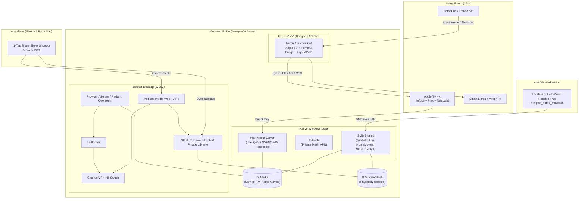

# Personal Media Stack — Architecture Blueprint & Implementation Roadmap

This blueprint synthesizes every decision from our scoping interview into an end-to-end architecture spanning your **always-on Windows 11 Pro server**, **Apple TV 4K + HomePod living room**, **macOS editing workstation**, and **strictly isolated private library**.

All companion configuration files and scripts are generated in your starter bundle:
- [README.md](file:///Users/derekolson/.gemini/antigravity/scratch/media-stack/README.md)
- [docker-compose.yml](file:///Users/derekolson/.gemini/antigravity/scratch/media-stack/docker/docker-compose.yml) & [.env.example](file:///Users/derekolson/.gemini/antigravity/scratch/media-stack/docker/.env.example)
- [setup-folders.ps1](file:///Users/derekolson/.gemini/antigravity/scratch/media-stack/windows/setup-folders.ps1)
- [automations_and_scripts.yaml](file:///Users/derekolson/.gemini/antigravity/scratch/media-stack/home-assistant/automations_and_scripts.yaml) & [homekit_bridge_config.yaml](file:///Users/derekolson/.gemini/antigravity/scratch/media-stack/home-assistant/homekit_bridge_config.yaml)
- [README-shortcuts-and-bookmarklet.md](file:///Users/derekolson/.gemini/antigravity/scratch/media-stack/shortcuts/README-shortcuts-and-bookmarklet.md)
- [ingest_home_movie.sh](file:///Users/derekolson/.gemini/antigravity/scratch/media-stack/editing/ingest_home_movie.sh)

---

## 1. System Architecture



### Why This Exact Split Matters
1. **Plex Native on Windows 11**: Avoids Docker/WSL2 GPU passthrough headaches and unlocks native **Intel Quick Sync / NVIDIA NVENC** hardware transcoding.
2. **Home Assistant OS in Hyper-V (Bridged NIC)**: Docker Desktop on Windows uses WSL2 NAT networking, which breaks mDNS discovery for **Apple TV (`pyatv`)** and **HomeKit Bridge**. Giving HAOS its own bridged LAN IP makes Siri, HomePod, Apple TV, Hue, and AVR discovery rock-solid.
3. **Hardlink-Ready `/data` Volume**: Mounting `D:/Media` as a single `/data` root into Sonarr/Radarr enables instant atomic moves and zero-duplicate hardlinks (following TRaSH Guides).
4. **Hard Physical Isolation for Stash**: `D:/Private/stash` is **never** mounted into Plex or `*arr`. Zero accidental thumbnails, Continue Watching leaks, or cross-indexing in the living room.

---

## 2. Phased Implementation Roadmap

### Phase 1: Windows 11 Server Foundation
1. **Static LAN IP & Power Reliability**
   - Reserve a static IP for your Windows 11 PC in your router's DHCP settings.
   - In BIOS/UEFI, set **Restore on AC Power Loss -> Power On** so the server recovers automatically after a power outage.
   - Run [setup-folders.ps1](file:///Users/derekolson/.gemini/antigravity/scratch/media-stack/windows/setup-folders.ps1) in an elevated PowerShell window to create the entire folder tree and disable sleep/hibernate on AC power.
2. **Core Native Installs**
   - Install **Tailscale** for Windows (sign in, enable unattended mode so it stays connected before Windows login).
   - Install **Plex Media Server** (native Windows). Point libraries strictly at:
     - `D:\Media\library\movies` -> **Movies**
     - `D:\Media\library\tv` -> **TV Shows**
     - `D:\Media\library\home-movies` -> **Home Movies** (library type: *Other Videos*, Scanner: *Plex Video Files Scanner*)
   - Enable Hardware Acceleration in Plex (**Settings -> Transcoder -> Use hardware acceleration when available**).
3. **SMB Shares for Your Mac**
   - Run the `New-SmbShare` commands printed at the end of `setup-folders.ps1` so your Mac can mount `MediaEditing` and `HomeMovies` over LAN (and optionally `StashPrivate$` as a hidden share).

---

### Phase 2: Docker Stack (`*arr` + VPN + Isolated Stash & MeTube)
1. Install **Docker Desktop for Windows** (with the WSL2 backend enabled and **"Start Docker Desktop when you sign in to your computer"** checked).
2. Copy [docker/.env.example](file:///Users/derekolson/.gemini/antigravity/scratch/media-stack/docker/.env.example) to `docker/.env` and fill in your drive paths and **ExpressVPN Manual Configuration OpenVPN** credentials (*ExpressVPN web dashboard -> Set Up Other Devices -> Manual Configuration* — note that these are different from your regular ExpressVPN account email/password).
3. Launch the stack from the `docker/` folder:
   ```powershell
   docker compose up -d
   ```
4. **Verify VPN Isolation** before adding any indexers:
   ```powershell
   docker exec qbittorrent curl -s ifconfig.me
   ```
   Confirm the returned IP belongs to your VPN provider, not your home ISP.
5. **Lock Down Stash Immediately**:
   - Open `http://<WIN11_IP>:9999` -> **Settings -> Security** -> create a strong Username & Password.
   - Configure **Settings -> Tasks** to scan `/data/inbox` on a schedule (or enable the AutoScan plugin) so MeTube downloads appear automatically with generated previews and thumbnails.
6. **Wire `*arr` Apps**:
   - **Prowlarr** (`:9696`): Add indexers and sync to Sonarr (`:8989`) and Radarr (`:7878`).
   - **qBittorrent** (`:8080`): Set default save path to `/data/torrents` and enable categories `movies` and `tv`.
   - **Sonarr / Radarr**: Point root folders to `/data/library/tv` and `/data/library/movies`, and enable **Use Hardlinks instead of Copy**.
   - **Overseerr** (`:5055`): Link to your Plex server, Sonarr, and Radarr for a clean Netflix-style request UI.

> [!TIP]
> If any adult site blocks your VPN IP in MeTube, you can remove `network_mode: "service:gluetun"` from the `metube` service in `docker-compose.yml` and move port `8081:8081` onto `metube` directly while keeping `qbittorrent` locked behind Gluetun.

---

### Phase 3: Home Assistant OS (Hyper-V) + Hands-Free Siri Voice Control
1. **Enable Hyper-V & Create Bridged Switch**
   - In Hyper-V Manager -> **Virtual Switch Manager** -> create a new **External** virtual switch bound to your PC's Ethernet adapter.
   - Download the official **Home Assistant OS `.vhdx` image** (Hyper-V), create a Generation 2 VM (4 GB RAM, 2 vCPUs, **Disable Secure Boot**, attach the External switch, set **Automatic Start Action -> Always start this virtual machine**).
   - Reserve a static DHCP IP for the HAOS VM on your router and install the **Tailscale Add-on** inside HAOS.
2. **Connect Your Living Room**
   - Add the **Apple TV**, **Plex Media Server**, **Lights (Hue/Matter)**, and **AVR/TV** integrations in HA (**Settings -> Devices & Services**).
3. **Expose Curated Siri Commands**
   - Paste [automations_and_scripts.yaml](file:///Users/derekolson/.gemini/antigravity/scratch/media-stack/home-assistant/automations_and_scripts.yaml) and [homekit_bridge_config.yaml](file:///Users/derekolson/.gemini/antigravity/scratch/media-stack/home-assistant/homekit_bridge_config.yaml) into HA, replacing placeholder entity IDs with your real entities.
   - Pair the **Media Stack Bridge** QR code in the Apple **Home** app.
   - You now have hands-free HomePod/iPhone Siri control:
     - *"Hey Siri, Movie Night"* -> turns on Apple TV/TV/AVR, opens Infuse, dims lights to 10%.
     - *"Hey Siri, Intermission"* -> pauses Apple TV, raises lights to 40%.
     - *"Hey Siri, Living Room TV Off"* -> powers down Apple TV, AVR/TV (via CEC), and lights.
     - **Automatic Cinema Lighting**: After sunset, hitting Play in Infuse/Plex dims lights automatically; pausing brings them back up gently.
4. **Dynamic Plex Voice Search ("Play [Title] on Plex")**
   - Follow Section 3 of [README-shortcuts-and-bookmarklet.md](file:///Users/derekolson/.gemini/antigravity/scratch/media-stack/shortcuts/README-shortcuts-and-bookmarklet.md) to build the 3-action Siri Shortcut that posts to HA's `/api/webhook/play_plex_title` endpoint, and enable **Personal Requests** on your HomePod.

---

### Phase 4: Streamlined Apple TV 4K + Private Stash Playback
1. **Streamline the Living Room Home Screen**
   - Install **Infuse** on Apple TV 4K and sign into your Plex server via **Direct Mode / Plex Sync**. Infuse handles Dolby Vision, HDR10+, lossless audio, and high-bitrate personal movies smoothly without triggering Plex transcodes.
   - Place **Infuse** (and optionally **Plex**) in the **Top Shelf** row of Apple TV for instant Up Next / Recently Added access.
   - Install the native **Tailscale** tvOS app if you ever travel with the Apple TV or want seamless remote mesh routing.
2. **Private Stash Access (Zero Living-Room Leaks)**
   - **Primary (Phones/iPad/Mac)**: Add Stash (`http://<WIN11_TAILSCALE_IP>:9999`) to your iPhone Home Screen as a PWA. Works identically at home and remotely via Tailscale.
   - **1-Tap Downloads**: Build the **"Send to Stash"** Share Sheet Shortcut & browser bookmarklet from [README-shortcuts-and-bookmarklet.md](file:///Users/derekolson/.gemini/antigravity/scratch/media-stack/shortcuts/README-shortcuts-and-bookmarklet.md).
   - **Private Apple TV Playback (2 options)**:
     - *Cleanest / Zero Trace*: Open a scene in Stash on your iPhone/iPad and **AirPlay** it directly to the Apple TV. Nothing is ever stored or browsable on the Apple TV itself.
     - *Native App / PIN-Locked*: In Infuse, enable **Passcode Lock** on a dedicated folder/share pointing to your hidden `\\<WIN11_IP>\StashPrivate$` SMB share and exclude that share from Infuse's Library/Up Next indexing.

---

### Phase 5: Personal Movie Editing Pipeline (macOS -> Windows 11 Plex)
1. **Install Tools on Your Mac**
   - **LosslessCut** (free, open-source): For instant frame/keyframe trimming, splitting, and merging clips with zero quality loss.
   - **DaVinci Resolve (Free)**: For full creative edits (color grading, music, titles, transitions).
   - **FFmpeg**: Install via Homebrew (`brew install ffmpeg`) to power the automated ingest script.
2. **Mount the Windows 11 Shares on macOS**
   - In Finder press `Cmd + K` -> connect to `smb://<WIN11_IP>/MediaEditing` and `smb://<WIN11_IP>/HomeMovies` (save credentials in Keychain and add to Login Items if desired).
3. **End-to-End Editing & Ingest Workflow**
   - **Step 1 (Raw Import)**: Drop iPhone/camera footage into `01_raw_imports`.
   - **Step 2 (Edit)**:
     - *Quick trim/merge*: Open in **LosslessCut** -> export directly to `03_ingest_ready`.
     - *Full creative edit*: Edit in **DaVinci Resolve** (keep Resolve's cache/proxy media on your Mac's internal SSD for silky scrubbing, then export final master MP4/MOV to `03_ingest_ready`).
   - **Step 3 (Batch Optimize & Auto-File)**: Run [ingest_home_movie.sh](file:///Users/derekolson/.gemini/antigravity/scratch/media-stack/editing/ingest_home_movie.sh):
     - Standard (compresses with Apple Silicon `hevc_videotoolbox`, normalizes audio to `-16 LUFS`, adds `+faststart`, preserves recording date):
       ```bash
       ./editing/ingest_home_movie.sh
       ```
     - Lossless remux (already exported at final bitrate from DaVinci Resolve / LosslessCut; zero re-encode):
       ```bash
       ./editing/ingest_home_movie.sh --lossless
       ```
   - Finished files land cleanly in `HomeMovies/YYYY/YYYY-MM-DD - Event Name.mp4`, originals are safely moved to `04_archived_originals`, and Plex auto-scans them onto your Apple TV!

---

## 3. Recommended Next Steps
1. Open the starter bundle directory (`/Users/derekolson/.gemini/antigravity/scratch/media-stack`) as your active workspace if you want to customize drive letters, VPN provider, or entity names together.
2. Tell me which phase you'd like to execute first — for example, we can immediately install the macOS editing tools (`ffmpeg`, LosslessCut) and test `ingest_home_movie.sh` locally, or tailor `docker-compose.yml` to your exact VPN provider and Windows drive letters.
